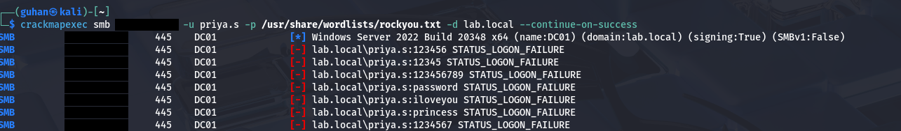

# 1. Brute-force / Password Spray

**MITRE ATT&CK:** [T1110 — Brute Force](https://attack.mitre.org/techniques/T1110/)
**Status:** Done

## Attack

Ran a password-spray against a domain account over SMB from Kali, using
`crackmapexec` with a large wordlist:

```bash
crackmapexec smb <dc-ip> -u <target-user> -p /usr/share/wordlists/rockyou.txt -d lab.local --continue-on-success
```

Stopped after a couple of minutes — long enough to generate a large burst of
failed logons (10,000+ in this run) without exhausting the wordlist.


*crackmapexec spraying rockyou.txt against a domain account over SMB (IPs redacted)*

## Detection

No custom rule needed — **Wazuh's built-in correlation rule already catches
this.**

- Each failed attempt logs as Windows Event ID **4625**, matched by Wazuh base
  rule **60122** ("Logon Failure - Unknown user or bad password", level 5)
- Once enough `60122` events fire from the same source in a short window,
  Wazuh escalates to rule **60204** — **"Multiple Windows Logon Failures"**,
  level 10

Searched in Discover:
