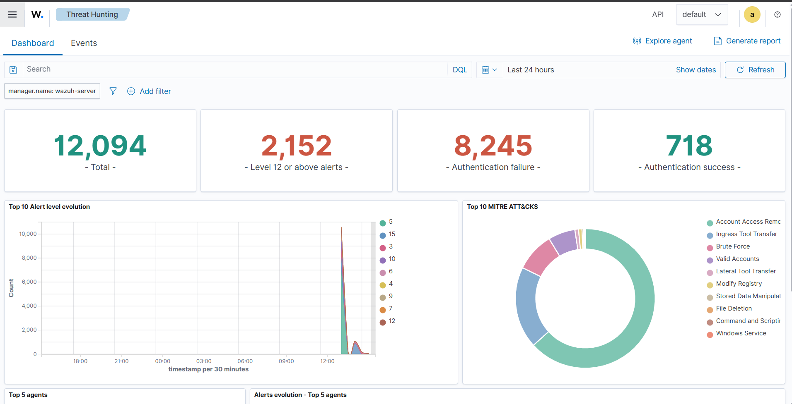
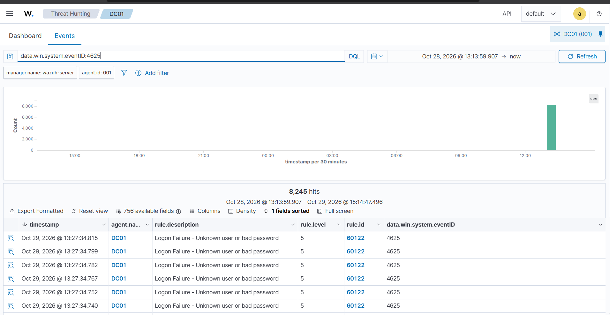

and confirmed the `60204` escalation fired alongside the raw `60122` events.

*Wazuh Threat Hunting dashboard — spike in alert volume and "Brute Force" visible in the Top 10 MITRE ATT&CKs chart*

*Discover view of raw `4625` failed-logon events matched to rule `60122`, confirming the volume generated by the attack*

## Notes

Wazuh's default threshold for `60204` worked out of the box for this lab's
scale/timing; worth checking the exact `frequency`/`timeframe` values on the
base rule if tuning is ever needed for a quieter/noisier attack pace.
